

 

&nbsp;

&nbsp;

&nbsp;

 

<a href="https://github.com/SardarHussain65">
  
</a>

 

<a href="https://github.com/SardarHussain65">
  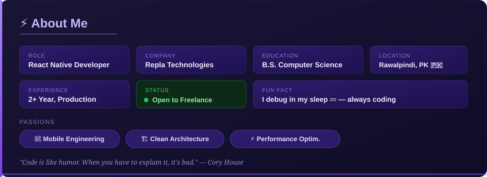
</a>

 

 

<a href="https://github.com/SardarHussain65">
  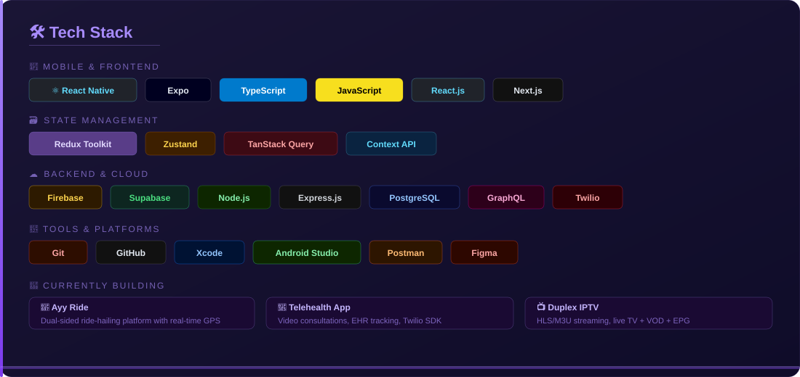
</a>

 

 

<a href="https://github.com/SardarHussain65">
  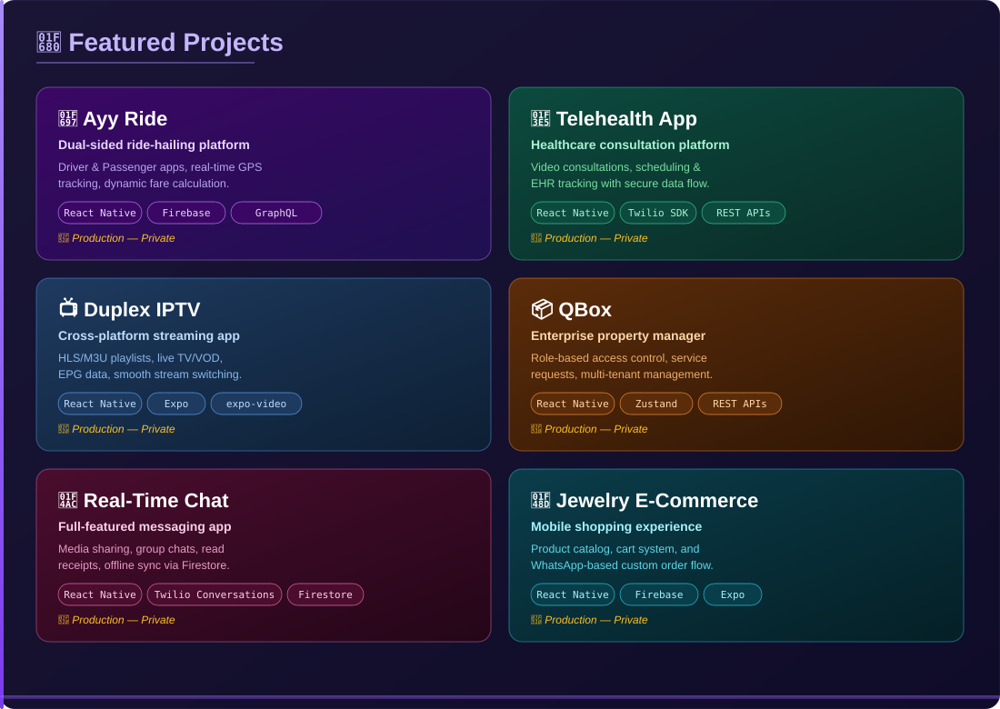
</a>

 

 

## 📈 Activity Graph

  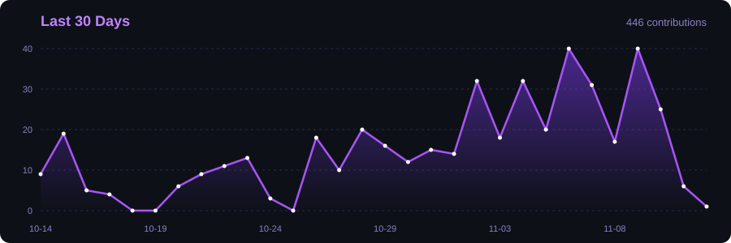

<b>📅 Last 3 months</b>

 

  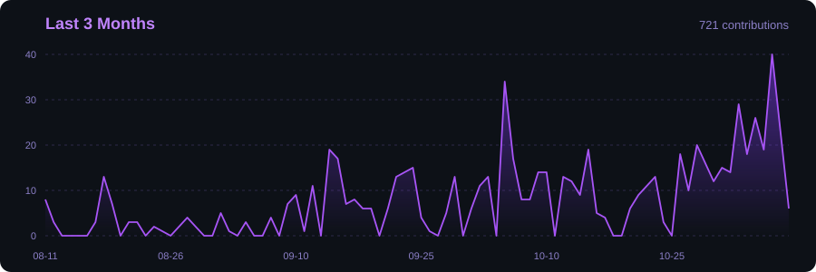

<b>🗓️ Whole year</b>

 

  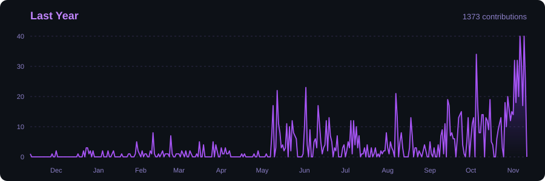

<b>⏪ Previous months</b>

 

  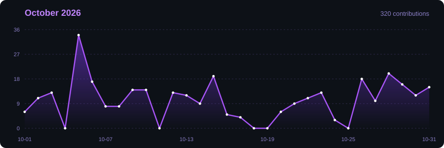
  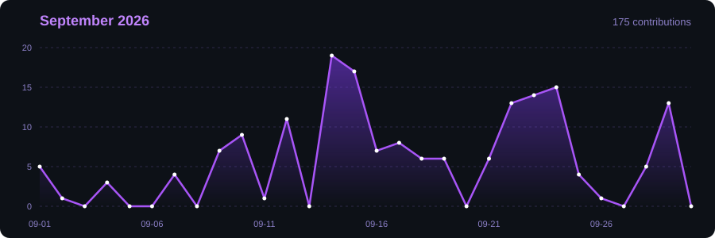
  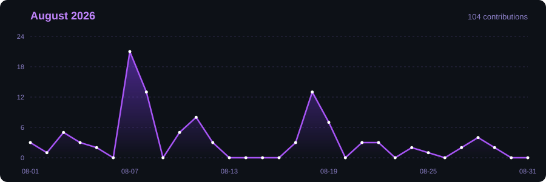

 

 

## 🐍 Contribution Snake

<picture>
  <source media="(prefers-color-scheme: dark)" srcset="https://raw.githubusercontent.com/SardarHussain65/SardarHussain65/output/github-contribution-grid-snake-dark.svg">
  <source media="(prefers-color-scheme: light)" srcset="https://raw.githubusercontent.com/SardarHussain65/SardarHussain65/output/github-contribution-grid-snake.svg">
  
</picture>

 

 

## 🎯 2026 Roadmap

<a href="https://github.com/SardarHussain65">
  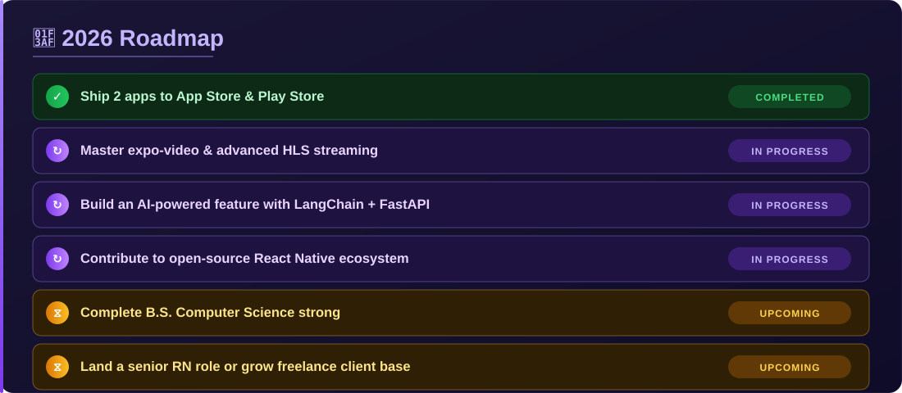
</a>

 

 

&nbsp;

&nbsp;

&nbsp;

 

 

💡 <i>"Code is like humor. When you have to explain it, it's bad."</i> — Cory House

 

